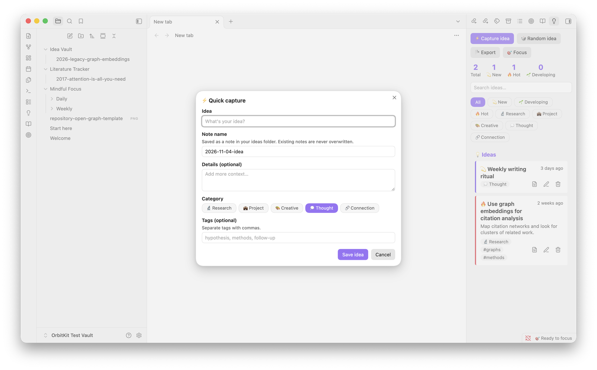

# Idea Vault

Capture ideas instantly, organize them later, and resurface forgotten ones.

## Features

- **Quick capture** with a title, optional details, a category and tags. Each idea gets its own note.
- **Categories**: Research, Project, Creative, Thought, Connection.
- **Statuses**: New → Developing → Hot → Implemented → Archived.
- Search, plus filters by status or category, in the side panel.
- **Random idea** resurfaces something you haven't finished with.
- **Export** writes a Markdown digest of all ideas (`Ideas-YYYY-MM.md`).

Editing an idea updates only the properties you changed, plus the note's
title and **💭 Idea** section. If you've edited those parts directly in the
note, your version is kept and Idea Vault tells you so. Everything else you
write in the note, including the **📝 Notes** section, is never touched. If
you rename or move an idea note, the idea follows it, even when the move
happens outside Obsidian.

## Commands

| Command | What it does |
| :-- | :-- |
| Quick capture idea | Opens the capture dialog |
| Open panel | Shows the side panel (also the 💡 ribbon icon) |
| Show a random idea | Picks an idea that isn't implemented or archived |
| Export ideas to Markdown | Writes the export note and opens it |

No hotkeys are set by default. Assign your own under **Settings → Hotkeys**.
In the dialogs, Ctrl/Cmd+Enter saves.

## Settings

| Setting | Default | Used for |
| :-- | :-- | :-- |
| Ideas folder | `Idea Vault` | Where idea notes and exports are saved (paths outside the vault are rejected) |
| Open note after capture | on | Opens the new note after Quick capture |

## Your data

The list of ideas lives in this plugin's `data.json`, and each idea also has
a readable note in the ideas folder. New notes never overwrite an existing
file: if the name is taken, Idea Vault adds a number, as in "My idea 1". When
you delete an idea, Idea Vault asks first, then moves its note to the trash
you've set in Obsidian.

## Install

**From Obsidian:** open **Settings → Community plugins → Browse**, search for
**Idea Vault**, then click **Install** and **Enable**.

**By hand:** download `main.js`, `manifest.json` and `styles.css` from the
[latest release](https://github.com/nooshinjava/obsidian-idea-vault/releases/latest) into
`<your vault>/.obsidian/plugins/idea-vault/`, reload Obsidian and enable
**Idea Vault** under **Settings → Community plugins**.

## Feedback

I'd love to hear how Idea Vault works for you. Please open an
[issue](https://github.com/nooshinjava/obsidian-idea-vault/issues) for bugs or ideas.

Idea Vault is part of [OrbitKit](https://github.com/nooshinjava/OrbitKit),
where I develop it together with my other Obsidian plugins. This repository is
generated from there.

## Acknowledgements

I designed and built Idea Vault. I used [Claude](https://www.anthropic.com/claude),
an AI assistant by Anthropic, to help with parts of the code, tests and
documentation.

## License

[MIT](LICENSE) © Nooshin Javaheripour
